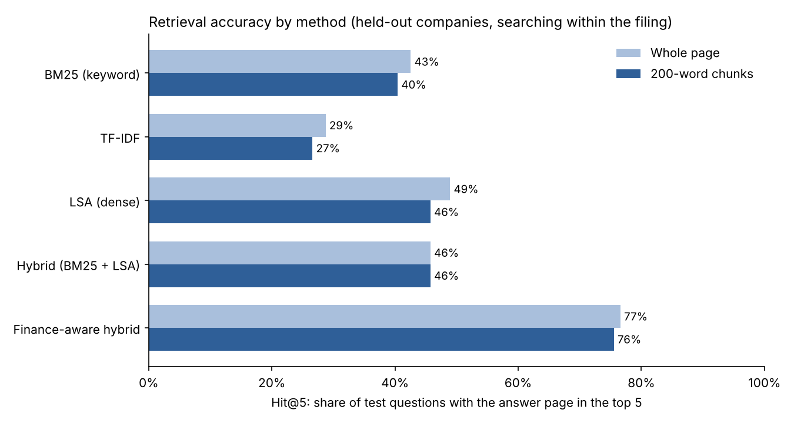
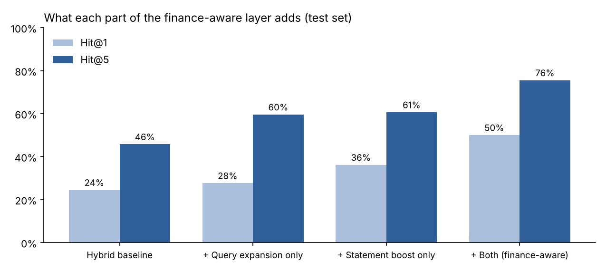
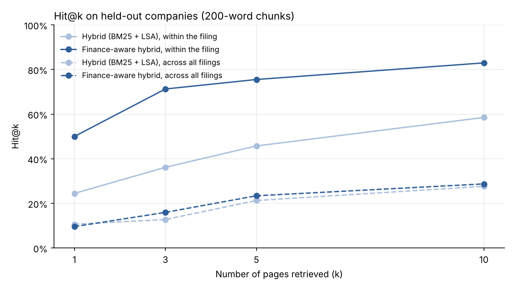

# Financial Report RAG: Ask Questions of 10-K Filings

A retrieval-augmented generation (RAG) tool that answers questions about company annual reports and cites the pages it used. The focus is the part most RAG demos skip: **measuring whether retrieval actually finds the right page**, finding out why it fails, and fixing it.

On real 10-K filings, a standard hybrid search found the answer page in its top 5 results for only **46%** of questions. Adding a small finance-aware layer raised that to **76%** on companies it was never tuned on, and put the right page **first 50% of the time, up from 24%**.



## What it does

```bash
python ask.py --doc COSTCO_2021_10K "How much total assets did Costco have at the end of FY2021?"
```

```
[1] COSTCO_2021_10K, page 38
    COSTCO WHOLESALE CORPORATION CONSOLIDATED BALANCE SHEETS (amounts in millions ...)
    ASSETS CURRENT ASSETS Cash and cash equivalents $ 11,258 ...
```

It searches the filing, returns the most relevant passages with page numbers and, with a Claude API key, writes an answer that cites every number to a page, for example `[p. 38]`. If the passages don't contain the answer, it is told to say so instead of guessing.

## How it works

```
10-K PDF ─► Extract text per page ─► Split into 200-word chunks (each keeps its page number)
                                               │
Question ─► Finance-aware query layer ─► Hybrid search ─► Top passages ─► Claude answer with [p. N] citations
             • strip formatting instructions    • BM25 keyword scores
             • expand analyst terms             • LSA dense vectors
             • detect statements needed         • fused with reciprocal rank fusion
                                                • statement pages boosted
```

1. **Ingest:** PyMuPDF extracts each page; pages are split into overlapping 200-word chunks so every chunk can be cited to an exact page.
2. **Search:** two complementary methods are combined with reciprocal rank fusion:
   - **BM25** for exact keyword matches (tickers, line items, years)
   - **LSA** (TF-IDF reduced to 256 dimensions with SVD) as a lightweight dense, "semantic" vector search
3. **Finance-aware query layer** ([`finance_query.py`](report_rag/finance_query.py)), the main contribution:
   - removes answer-formatting noise such as "round your answer to two decimal places"
   - expands analyst shorthand into the words filings use, for example *capex* to *purchases of property, plant and equipment*, and *quick ratio* to *total current assets, total current liabilities, receivables*
   - works out which financial statements the question needs (balance sheet, income statement, cash flow statement) and boosts pages whose header shows that statement
4. **Answer:** the top passages go to Claude with instructions to answer only from them and cite pages.

Everything up to the answer step runs locally with scikit-learn: no model downloads, no API key and no vector database.

## How it was evaluated

The project uses the open-source sample of **FinanceBench** (Islam et al., 2023): 150 questions written by financial analysts about 84 real filings from 32 companies, each labelled with the page that contains the answer.

- **Metric:** Hit@k is the share of questions where a correct page is among the top k pages retrieved. MRR@10 rewards ranking the correct page higher.
- **No tuning on the test data:** companies were split alphabetically. The finance layer was designed and its settings chosen using only the first 10 companies (56 questions). All headline numbers come from the other **22 companies (94 questions)** it never saw.
- **Search scope:** the main results search within the filing the question is about, which matches how the tool is used (you pick a filing, then ask).

## Results (held-out companies)

Searching within the filing, 200-word chunks, 94 test questions:

| Method | Hit@1 | Hit@3 | Hit@5 | Hit@10 | MRR@10 |
|---|---|---|---|---|---|
| BM25 (keyword) | 17.0% | 30.9% | 40.4% | 51.1% | 0.266 |
| TF-IDF | 11.7% | 20.2% | 26.6% | 40.4% | 0.187 |
| LSA (dense) | 22.3% | 37.2% | 45.7% | 56.4% | 0.321 |
| Hybrid (BM25 + LSA) | 24.5% | 36.2% | 45.7% | 58.5% | 0.335 |
| **Finance-aware hybrid** | **50.0%** | **71.3%** | **75.5%** | **83.0%** | **0.608** |

Whole-page retrieval gave similar results (finance-aware Hit@5 of 76.6%). 200-word chunks were chosen because they scored better on the dev companies (69.6% vs 64.3%).

### What each part of the finance layer adds



| Setup (test set) | Hit@1 | Hit@5 | MRR@10 |
|---|---|---|---|
| Hybrid baseline | 24.5% | 45.7% | 0.335 |
| + Query expansion only | 27.7% | 59.6% | 0.418 |
| + Statement boost only | 36.2% | 60.6% | 0.471 |
| + Both | **50.0%** | **75.5%** | **0.608** |

Each piece helps on its own, but they work best together. Expansion makes the right line items match, and the statement boost lifts the page those line items sit on.

### Where it helps and where it still struggles

| Question type (test set) | Questions | Hybrid Hit@5 | Finance-aware Hit@5 |
|---|---|---|---|
| Metric questions ("FY2021 capex", "quick ratio") | 33 | 36.4% | **100.0%** |
| Company-specific questions | 36 | 69.4% | 72.2% |
| Judgment questions ("is this business capital-intensive?") | 25 | 24.0% | 48.0% |
| Answers spread over 2+ pages | 24 | 25.0% | 70.8% |

- **Metric questions are now solved at the retrieval step:** the correct statement page is in the top 3 for every one of the 33 test questions.
- **Judgment questions remain hard.** They don't name a line item or statement, so there is little to match on. A neural embedding model or a re-ranker is the natural next step here.
- **Searching all 84 filings at once is much harder** (finance-aware Hit@5 of 23.4% with chunks, 36.2% with whole pages), because many filings come from the same company in different years and look alike. In practice you pick the filing first, which the tool does.
- **The metric is strict.** Only the labelled page counts, even if the same number appears elsewhere. For example, American Express's effective tax rate appears on page 146 as well as on the labelled page 44, so true accuracy is a little higher than reported.



## Run it

```bash
pip install -r requirements.txt

# 1. Download the questions and filings (~160 MB, from the FinanceBench repo)
python scripts/download_data.py

# 2. Reproduce the evaluation (a couple of minutes on a laptop)
python evaluate.py

# 3. Ask your own questions
python ask.py --list
python ask.py --doc PEPSICO_2022_10K "What was PepsiCo's free cash flow in 2022?"

# Optional: written answers with page citations from Claude
export ANTHROPIC_API_KEY=your_key
python ask.py --doc PEPSICO_2022_10K "What was PepsiCo's free cash flow in 2022?"
```

Use `--method` to compare `bm25`, `tfidf`, `lsa`, `hybrid` and `finance` (default), and `--model` to choose the Claude model.

## Project structure

```
ask.py                         Ask a question about a filing
evaluate.py                    Reproduces every number and chart in this README
report_rag/
  ingest.py                    PDF to page-tagged chunks
  retrieve.py                  BM25, TF-IDF, LSA, hybrid and finance-aware search
  finance_query.py             Query cleanup, finance glossary, statement detection
  answer.py                    Prompt and Claude call with page citations
scripts/download_data.py       Fetches FinanceBench questions and filings
results/                       Metrics, per-question ranks and charts
```

## Limitations and next steps

- The answer-writing step was not scored here (it needs an API key); only retrieval is measured. A natural extension is scoring answers against FinanceBench's gold answers.
- LSA is a lightweight stand-in for neural embeddings. Swapping in a sentence-embedding model and adding a cross-encoder re-ranker should help most on judgment questions.
- PDF tables are read as plain text, so column alignment is lost. Table-aware extraction would make calculated answers more reliable.
- The finance glossary is hand-written and covers common metrics; it would need extending for sector-specific terms (banking, insurance).

## Data and credit

Questions and filings come from the open-source sample of [FinanceBench](https://github.com/patronus-ai/financebench) by Patronus AI. They are downloaded at runtime and not stored in this repository. The filings themselves are public company reports.

> Islam, P., Kannappan, A., Kiela, D., Qian, R., Scherrer, N., and Vidgen, B. (2023). *FinanceBench: A New Benchmark for Financial Question Answering.* arXiv:2311.11944.

## Tech stack

Python · PyMuPDF · scikit-learn (BM25, TF-IDF, LSA) · pandas · Matplotlib · Anthropic Claude API
